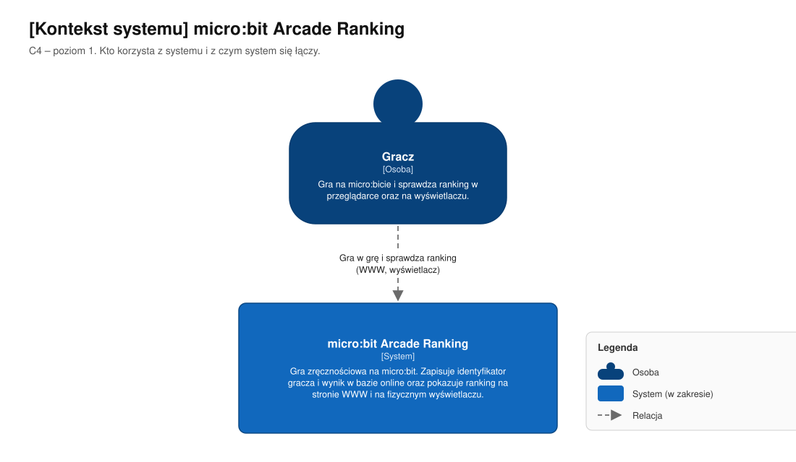
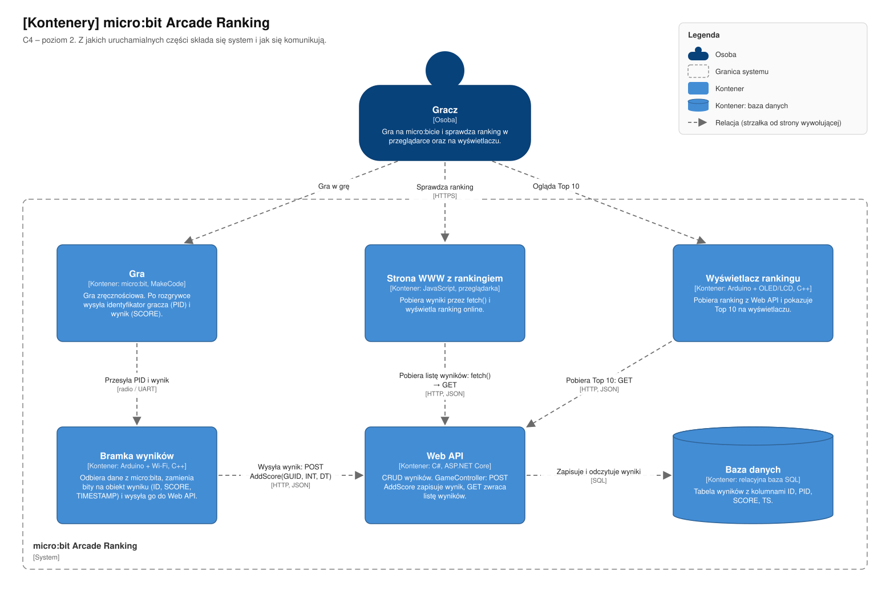
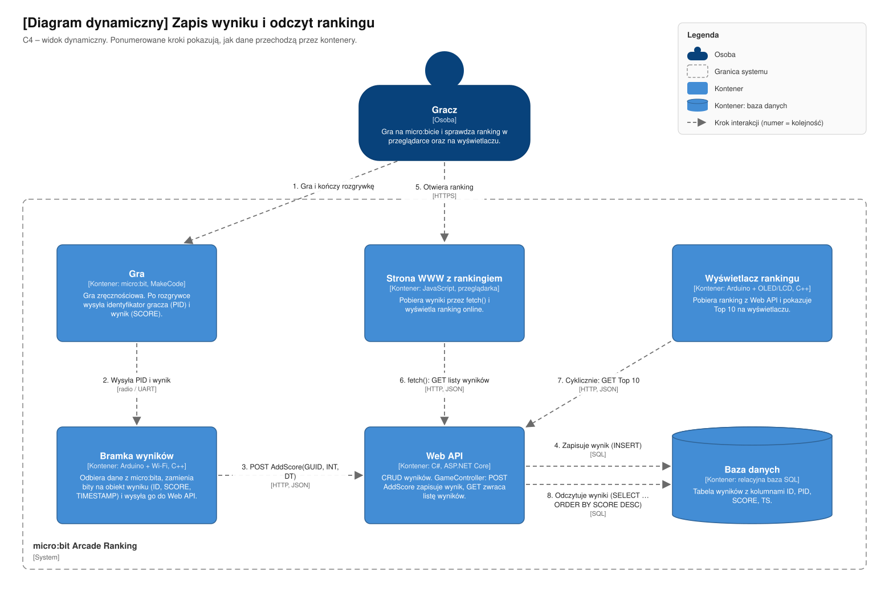
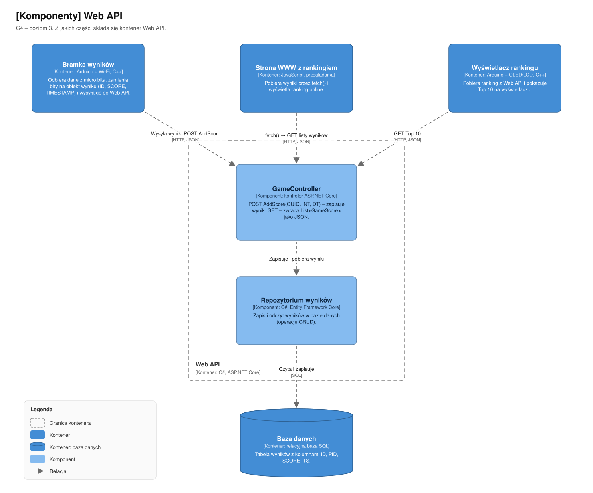
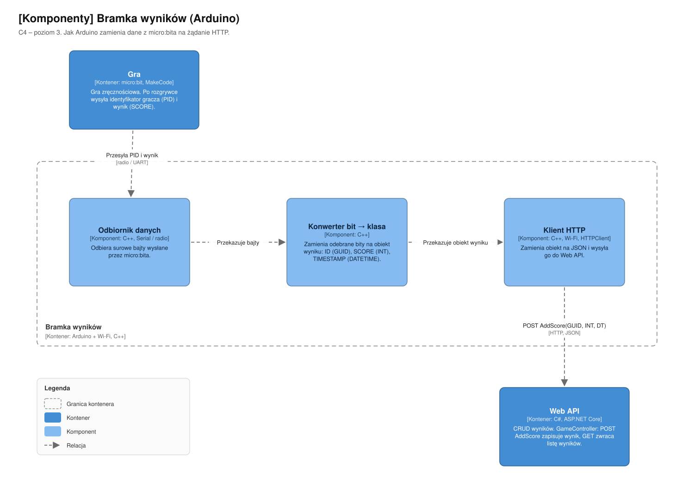
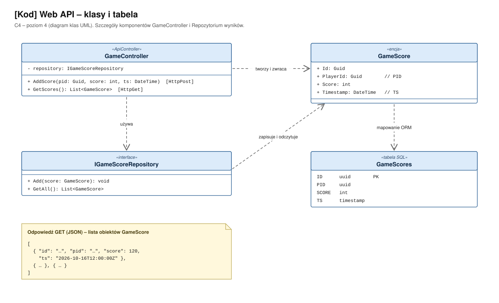

# Architektura w modelu C4

Architektura narysowana na tablicy podczas zajęć, przedstawiona w modelu C4 Simona Browna
(zob. [Architektura i Model C4](https://it-consulting.pl/2025/02/12/architektura-c4/)).

Model C4 to cztery poziomy przybliżenia, jak na mapie:

| Poziom | Diagram | Na jakie pytanie odpowiada |
|---|---|---|
| C1 | Kontekst systemu | Kto korzysta z systemu i z czym system się łączy? |
| C2 | Kontenery | Z jakich uruchamialnych części składa się system i jak się komunikują? |
| C3 | Komponenty | Z czego zbudowany jest pojedynczy kontener? |
| C4 | Kod | Jakie klasy realizują najważniejszy komponent? |

Dodatkowo diagram dynamiczny pokazuje kolejność kroków: jak wynik trafia do bazy i jak wraca do rankingu.

## Tablica → C4

| Na tablicy | W modelu C4 | Poziom |
|---|---|---|
| USR | Osoba „Gracz” | C1, C2 |
| MB, GAME, PID, SCORE | Kontener „Gra” (micro:bit, MakeCode) | C2 |
| strzałka MB → Arduino, RADIO | Relacja „Przesyła PID i wynik” [radio / UART] | C2 |
| ARDUINO C++, KONWERTER BIT => CLASS, ID: GUID, SCORE: INT, TIMESTAMP: DATETIME | Kontener „Bramka wyników” i jego komponenty | C2, C3 |
| HTTP | Relacja Bramka wyników → Web API [HTTP, JSON] | C2 |
| WEBAPI CRUD C#, GAMECONTROLLER, POST ADDSCORE(GUID, INT, DT), GET LIST&lt;GS&gt; | Kontener „Web API”, komponent GameController, klasy | C2, C3, C4 |
| DB z kolumnami ID, PID, SCORE, TS | Kontener „Baza danych”, tabela GameScores | C2, C4 |
| ARDUINO2 + DISPLAY, HTTP GET, TOP 10 | Kontener „Wyświetlacz rankingu” | C2 |
| JS FETCH() => RES | Kontener „Strona WWW z rankingiem” | C2 |
| [{}, {}, {}] z polami ID, PID, SCORE, TS | Odpowiedź GET w formacie JSON | C4 |

Strzałki w C4 wskazują stronę, która wywołuje (np. Wyświetlacz → Web API: GET).
Na tablicy niektóre strzałki pokazywały kierunek przepływu danych, więc są odwrócone.

## C1 – kontekst systemu

Gracz gra na micro:bicie i sprawdza ranking. Cała reszta jest wewnątrz systemu.
Na tablicy nie ma zewnętrznych systemów, więc diagram ma tylko dwa elementy.

## C2 – kontenery

Sześć uruchamialnych części: gra na micro:bicie, dwa Arduino (bramka wyników i wyświetlacz),
Web API w C#, baza danych i strona WWW. Wszystkie odczyty i zapisy przechodzą przez Web API.

## Diagram dynamiczny – zapis wyniku i odczyt rankingu

Kroki 1–4 to zapis wyniku po rozgrywce, kroki 5–8 to odczyt rankingu na stronie WWW i na wyświetlaczu.

## C3 – komponenty Web API

## C3 – komponenty bramki wyników (Arduino)

## C4 – kod Web API

Według Browna poziom kodu rysuje się tylko dla najważniejszych komponentów.
Tu jest to GameController razem z encją GameScore i tabelą w bazie.

## Założenia do potwierdzenia

Tych rzeczy nie ma wprost na tablicy, więc przyjęliśmy założenia:

1. **Połączenie micro:bit → Arduino.** Na tablicy przy strzałce jest prawdopodobnie „RADIO”,
   a w README projektu jest UART. Na diagramach zostało „radio / UART” do czasu decyzji.
2. **ID: GUID w klasie na Arduino to identyfikator gracza (PID).** AddScore(GUID, INT, DT) ma tylko
   trzy parametry, a tabela ma osobne kolumny ID i PID. ID rekordu nadaje więc Web API albo baza.
3. **Repozytorium wyników** (Entity Framework Core) i interfejs IGameScoreRepository zostały dodane,
   bo CRUD w Web API potrzebuje warstwy dostępu do danych. Na tablicy ich nie ma.
4. **Technologie:** „WebAPI C#” to ASP.NET Core, a „DB” to relacyjna baza SQL (konkretny silnik nie jest wybrany).
5. **Wyświetlacz pobiera Top 10 cyklicznie** (odpytuje Web API co kilka sekund).

Tablica różni się też od listy w głównym [README](../../README.md). Tam wyniki trafiają prosto do
Supabase, a tu przez własne Web API w C#. Diagramy pokazują wersję z tablicy.

## Pliki

- `workspace.dsl` – model w [Structurizr DSL](https://docs.structurizr.com/dsl): jeden model,
  z którego powstają wszystkie widoki. Podgląd w Structurizr Lite:
  `docker run -it --rm -p 8080:8080 -v ${PWD}/docs/c4:/usr/local/structurizr structurizr/lite`,
  potem <http://localhost:8080>.
- `*.svg` – diagramy wygenerowane skryptem `rysuj_diagramy.py`
  (`py docs/c4/rysuj_diagramy.py docs/c4`). Po zmianie architektury popraw oba pliki:
  model i skrypt.
